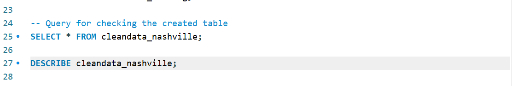
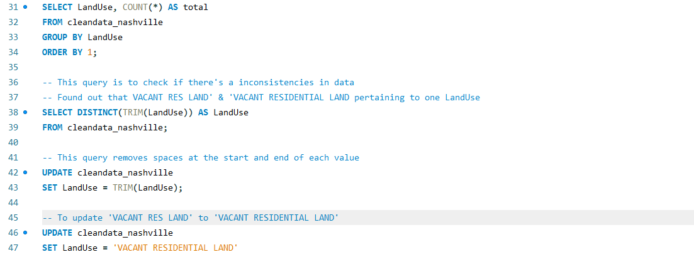

# Nashville Housing Data Cleaning Using MySQL

## Project Overview

This project focuses on cleaning and preparing the Nashville Housing dataset using MySQL. The goal is to improve data quality, standardize inconsistent values, handle missing information, separate address fields, and prepare the dataset for further analysis.

This project demonstrates my foundational SQL skills and my ability to organize and transform raw data into a cleaner, more structured dataset.

## Tools Used

- **Database:** MySQL
- **SQL Environment:** MySQL Workbench
- **Dataset:** Nashville Housing

## Objectives

- Create a separate working table while preserving the original dataset.
- Explore the dataset and understand its structure.
- Standardize inconsistent text values and date formats.
- Identify and handle missing property addresses.
- Split property and owner addresses into separate columns.
- Identify potential duplicate records.
- Remove unnecessary columns after validating the replacement fields.
- Validate the cleaned dataset.

## Data Cleaning Process

### 1. Data Backup

Created a separate table named `cleandata_nashville` using the original `nashville_housing` table as the source.

**SQL techniques:** `CREATE TABLE LIKE`, `INSERT INTO ... SELECT`

### 2. Data Exploration

Reviewed the dataset's records, column names, and data types to understand its structure and identify potential data quality issues.

**SQL techniques:** `SELECT`, `DESCRIBE`

### 3. Standardization

Standardized inconsistent `LandUse` values and removed unnecessary leading, trailing, and repeated spaces from address fields.

Converted the `SaleDate` column into the MySQL `DATE` data type and checked the `SoldAsVacant` column for inconsistent values.

#### LandUse Standardization

**SQL techniques:** `TRIM()`, `REPLACE()`, `STR_TO_DATE()`, `ALTER TABLE`, `UPDATE`

### 4. Handling Missing Values

Identified missing `PropertyAddress` values and used matching `ParcelID` records to find potential replacement addresses.

Updated missing values when a reliable matching address was available.

**SQL techniques:** `JOIN`, table aliases, `UPDATE`

### 5. Address Splitting

Separated `PropertyAddress` into `PropertyStreet` and `PropertyCity`.

Separated `OwnerAddress` into `OwnerSplitAddress`, `OwnerSplitCity`, and `OwnerSplitState`.

**SQL techniques:** `SUBSTRING_INDEX()`, `TRIM()`, `ALTER TABLE`, `UPDATE`

### 6. Duplicate Identification

Used a Common Table Expression (CTE) and the `ROW_NUMBER()` window function to identify potential duplicate records based on selected property and sale attributes.

The duplicate-checking query returned no additional records under the selected criteria, so no duplicate deletion was performed.

**SQL techniques:** CTEs, `ROW_NUMBER()`, `PARTITION BY`

### 7. Removing Unnecessary Columns

After creating and reviewing the split address columns, removed the original `PropertyAddress` and `OwnerAddress` columns from the cleaned table.

**SQL technique:** `ALTER TABLE ... DROP COLUMN`

### 8. Final Validation

Reviewed the cleaned dataset, checked the `UniqueID` count, and verified the standardized `SoldAsVacant` values.

Additional validation is important to confirm that the cleaning process preserved the required information and did not introduce errors.

## SQL Skills Demonstrated

- Data exploration and profiling
- Data standardization
- Date conversion
- Handling missing values
- Self-joins and table aliases
- String manipulation
- Column creation and modification
- Common Table Expressions (CTEs)
- Window functions
- Duplicate identification
- Data validation

## Project Outcome

The project demonstrates how SQL can be used to clean and structure a raw housing dataset before analysis. The cleaned table provides separate address fields, standardized values, and a more consistent date format.

This project strengthened my understanding of SQL data manipulation and data quality practices as part of my Data Analyst learning journey.

## Repository Contents

- `README.md` — Project documentation
- `Nashville_Housing_Cleaning.sql` — SQL queries used throughout the cleaning process

## Author

**Jerick Gamboa**

Aspiring Data Analyst | Information Technology Graduate

[GitHub Portfolio](https://github.com/Jerick-Gamboa/Data-Analyst-Portfolio)

